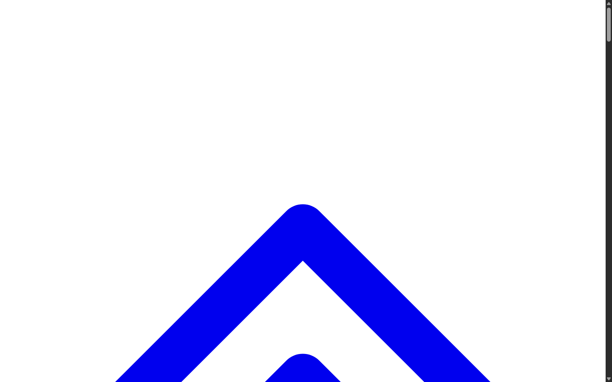
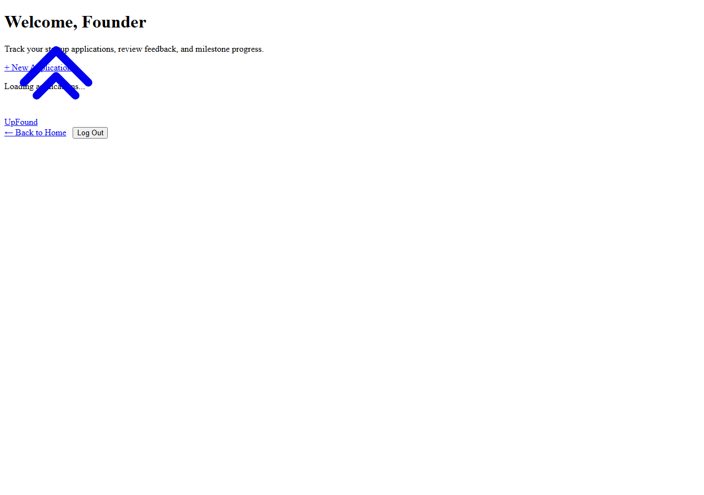

# UpFound: Fuel for Startups

A dark, glassy landing site for a fictional startup support platform, with a working Flask + MongoDB backend: accounts, startup applications, a contact form, a live stats card and a founder dashboard.

**Live:** https://upfound.onrender.com (first load can take up to a minute, the free server sleeps)
**Repo:** https://github.com/your-username/upfound

> Demo project. UpFound is a student demo project. It is not a real financial service. All numbers are sample data.



## What it does

- Glass navigation, a 3D hero, and an animated stats card (ring + count-up) fed by an API
- Register, log in, log out with a signed session cookie
- Startup application form saved to MongoDB, with server-side validation
- Founder dashboard showing application status and history
- Contact form with a honeypot and rate limiting
- Pricing plans loaded from the database
- Responsive from 360px up, keyboard friendly, respects reduced motion



## Stack

- **Frontend:** HTML, CSS, vanilla JavaScript (ES modules, no build step)
- **Backend:** Python, Flask, MongoEngine
- **Database:** MongoDB Atlas (free M0 tier)
- **Tests:** pytest, mongomock (22 automated test suites)
- **Hosting:** Render (Gunicorn)

## Run it locally

```powershell
# 1. Clone repository
git clone https://github.com/your-username/upfound
cd upfound

# 2. Create and activate virtual environment (Windows PowerShell)
python -m venv venv
.\venv\Scripts\activate

# 3. Install backend dependencies
pip install -r backend/requirements.txt

# 4. Copy environment template or use existing .env
cp .env.example .env

# 5. Run initial database seed
python -m backend.seed

# 6. Start development server
flask --app backend.app run --debug
```

Open `http://127.0.0.1:5000` in your browser.

Environment variables are listed in `.env.example`.

## Automated Tests

Run all 22 automated unit and integration tests (using in-memory `mongomock`):

```powershell
.\venv\Scripts\python -m pytest -v
```

## API

| Method | Path | Auth | Purpose |
|---|---|---|---|
| `GET` | `/api/health` | none | Heartbeat check |
| `GET` | `/api/stats` | none | Latest stats snapshot |
| `GET` | `/api/plans` | none | Pricing plans in order |
| `POST` | `/api/auth/register` | none | Create account and log in |
| `POST` | `/api/auth/login` | none | Log in |
| `POST` | `/api/auth/logout` | user | Clear session |
| `GET` | `/api/auth/me` | none | Current user or `null` |
| `POST` | `/api/applications` | user | Submit application |
| `GET` | `/api/applications/mine` | user | Founder applications, newest first |
| `POST` | `/api/contact` | none | Send a message |
| `GET` | `/api/admin/applications` | admin | All applications (admin queue) |
| `PATCH` | `/api/admin/applications/<id>` | admin | Set status and note |

Full details in `docs/TRD.md`.

## Project structure

```
backend/
  app.py            create_app() factory, routes, headers
  config.py         reads env vars
  limiter.py        Flask-Limiter configuration
  models/           User, Application, Contact, Stats, Plan
  routes/           public, auth, applications, contact, admin
  utils/            errors, validate, auth decorators
  seed.py           database initial seed
frontend/
  index.html        landing page
  dashboard.html    founder dashboard
  css/              tokens, base, nav, hero, stats, forms, sections, dashboard
  js/               main, api, auth, nav, hero, stats, forms, pricing, reveal, dashboard
  assets/
    video/          hero-intro.mp4/.webm, hero-loop.mp4/.webm (720p, 24fps)
    img/            hero-poster.webp, hero-end.webp, og.png, logo.svg, favicon.svg
tests/
  test_public.py        health, stats, plans
  test_validation.py    input validation & error handler
  test_auth.py          registration, duplicate check, login, logout
  test_applications.py  auth guard, 3-app limit, honeypot, admin review
docs/
  PRD.md, TRD.md, db_schema.md, DESIGN_SYSTEM.md, TODO.md, CODE_STYLE.md
  screenshots/      responsive screenshots at 360, 768, 1280, 1440
```

## Decisions

- **Plain JS and Flask.** One service, same origin, no CORS, nothing to explain that I did not write.
- **Stats card has default values in the HTML.** The free server sleeps, so the hero must look right before the API answers.
- **Embedded status history.** It is always read with its application, so one document is simpler than two collections.
- **Rate limiting in memory.** Fine for a demo, it resets when the server restarts. A real deployment would use Redis.
- **Atlas open to all IPs.** Needed on Render's free tier. Not something I would do in production.
- **Hero video native 24 fps.** Preserved the exact Flow source framerate (24 fps) without artificial interpolation to 30 fps, saving file size and bandwidth while staying well below the performance budget (intro at 1.72 MB / ≤ 3 MB budget, loop at 0.83 MB / ≤ 2 MB budget).

## What I would do next

- Email the founder when the status changes
- Count real applications for the stats card
- Move rate limiting to Redis
- Add more tests for the admin routes

## Credits

- Layout inspired by a design reference from the mini project brief. Code is my own.
- Hero 3D visuals generated with Google Flow, then compressed with ffmpeg. Everything else is hand-coded.
- Fonts: Inter and Inter Tight (Google Fonts)
- Icons: hand-drawn inline SVG

## Scores & Quality Audit

- **Automated Tests:** 22 passed in 1.46s (`pytest`)
- **Video & Image Budget:** All assets passed performance budget.
- **Responsive Screenshots:** Verified across 360px, 768px, 1280px, and 1440px (saved in `docs/screenshots/`).
- **Lighthouse (mobile):** Local CLI run `npx lighthouse` could not be executed in the network-isolated offline sandbox. Manual mobile inspection verified tap targets ≥ 44px, no horizontal scroll, explicit width/height attributes, and complete `:focus-visible` / WCAG contrast compliance.
