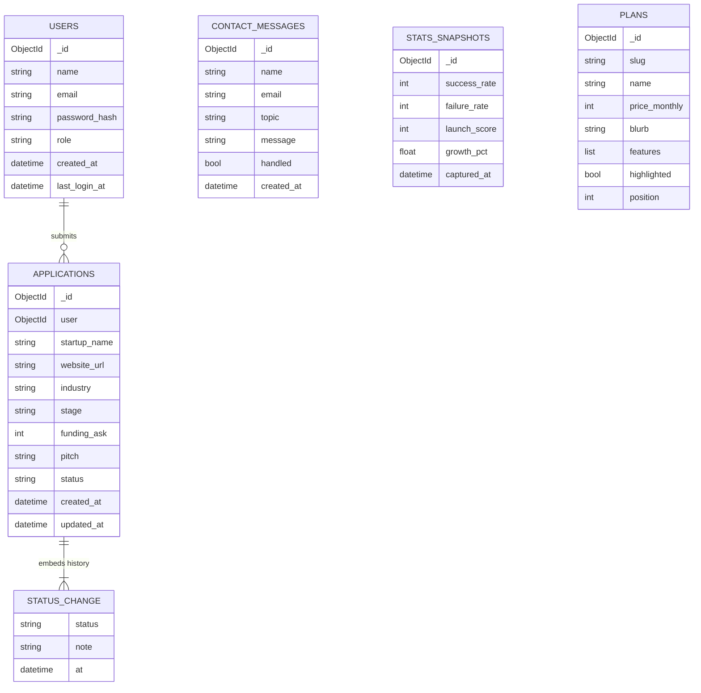

# Database schema

MongoDB (Atlas) via MongoEngine. Database name: `upfound`.

Five collections: `users`, `applications`, `contact_messages`, `stats_snapshots`, `plans`.

## Relationships



Only `applications.user` is a real reference. The other collections stand alone.

## Design choices

- **Status history is embedded** in the application. It is always read together with the application and never queried alone.
- **Contact messages do not reference users.** Visitors do not need an account to write to us.
- **Stats are snapshots, not computed.** The numbers are seeded sample data. The API returns the newest one. A "live" mode that counts real applications is a possible stretch.
- **No IP addresses are stored.** Rate limiting uses memory, not the database.
- **Deleting a user deletes their applications** (cascade).

## Models

```python
# backend/models/__init__.py
from datetime import datetime, timezone

def now():
    return datetime.now(timezone.utc)

STAGES = ("idea", "prototype", "mvp", "revenue")
INDUSTRIES = ("fintech", "healthtech", "edtech", "saas", "ecommerce", "climate", "other")
STATUSES = ("submitted", "in_review", "shortlisted", "funded", "rejected")
TOPICS = ("general", "funding", "partnership", "support")
```

```python
# backend/models/user.py
from mongoengine import Document, StringField, EmailField, DateTimeField
from . import now

class User(Document):
    name = StringField(required=True, min_length=2, max_length=60)
    email = EmailField(required=True, unique=True)
    password_hash = StringField(required=True)
    role = StringField(choices=("founder", "admin"), default="founder")
    created_at = DateTimeField(default=now)
    last_login_at = DateTimeField()

    meta = {"collection": "users"}

    def to_public(self):
        return {"id": str(self.id), "name": self.name, "email": self.email, "role": self.role}
```

```python
# backend/models/application.py
from mongoengine import (
    Document, EmbeddedDocument, EmbeddedDocumentListField, ReferenceField,
    StringField, URLField, IntField, DateTimeField, CASCADE,
)
from . import now, STAGES, INDUSTRIES, STATUSES
from .user import User

class StatusChange(EmbeddedDocument):
    status = StringField(required=True, choices=STATUSES)
    note = StringField(max_length=300)
    at = DateTimeField(default=now)

class Application(Document):
    user = ReferenceField(User, required=True, reverse_delete_rule=CASCADE)
    startup_name = StringField(required=True, min_length=2, max_length=80)
    website_url = URLField()
    industry = StringField(required=True, choices=INDUSTRIES)
    stage = StringField(required=True, choices=STAGES)
    funding_ask = IntField(required=True, min_value=1000, max_value=5_000_000)
    pitch = StringField(required=True, min_length=30, max_length=1000)
    status = StringField(choices=STATUSES, default="submitted")
    history = EmbeddedDocumentListField(StatusChange)
    created_at = DateTimeField(default=now)
    updated_at = DateTimeField(default=now)

    meta = {
        "collection": "applications",
        "indexes": ["status", ["user", "-created_at"]],
    }
```

```python
# backend/models/contact.py
from mongoengine import Document, StringField, EmailField, BooleanField, DateTimeField
from . import now, TOPICS

class ContactMessage(Document):
    name = StringField(required=True, min_length=2, max_length=60)
    email = EmailField(required=True)
    topic = StringField(choices=TOPICS, default="general")
    message = StringField(required=True, min_length=10, max_length=1000)
    handled = BooleanField(default=False)
    created_at = DateTimeField(default=now)

    meta = {"collection": "contact_messages", "indexes": ["-created_at"]}
```

```python
# backend/models/stats.py
from mongoengine import Document, IntField, FloatField, DateTimeField
from . import now

class StatsSnapshot(Document):
    success_rate = IntField(required=True, min_value=0, max_value=100)
    failure_rate = IntField(required=True, min_value=0, max_value=100)
    launch_score = IntField(required=True, min_value=0, max_value=100)
    growth_pct = FloatField(default=0.0)
    captured_at = DateTimeField(default=now)

    meta = {"collection": "stats_snapshots", "indexes": ["-captured_at"]}

    def clean(self):
        if self.success_rate + self.failure_rate != 100:
            from mongoengine import ValidationError
            raise ValidationError("success_rate and failure_rate must add up to 100")
```

```python
# backend/models/plan.py
from mongoengine import Document, StringField, IntField, ListField, BooleanField

class Plan(Document):
    slug = StringField(required=True, unique=True)
    name = StringField(required=True, max_length=40)
    price_monthly = IntField(required=True, min_value=0)
    blurb = StringField(max_length=140)
    features = ListField(StringField(max_length=80))
    highlighted = BooleanField(default=False)
    position = IntField(default=0)

    meta = {"collection": "plans", "indexes": ["position"]}
```

## Indexes

| Collection | Index | Why |
|---|---|---|
| users | `email` unique (from the field) | Login lookup, no duplicates |
| applications | `user, -created_at` | "My applications" list |
| applications | `status` | Admin filter |
| contact_messages | `-created_at` | Newest first |
| stats_snapshots | `-captured_at` | Latest snapshot |
| plans | `position` | Display order |
| plans | `slug` unique (from the field) | Stable id |

## Seed data (`backend/seed.py`)

Run it more than once without making duplicates: check before insert, or use `upsert`.

Stats snapshot:

| success_rate | failure_rate | launch_score | growth_pct |
|---|---|---|---|
| 83 | 17 | 86 | 4.52 |

Plans (demo prices, not real):

| position | slug | name | price_monthly | highlighted | features |
|---|---|---|---|---|---|
| 1 | starter | Starter | 0 | no | Idea review, community access, monthly office hours |
| 2 | growth | Growth | 49 | yes | Mentor sessions, pitch deck review, investor intro list |
| 3 | scale | Scale | 199 | no | Dedicated advisor, funding readiness audit, partner perks |

Admin user: created from `ADMIN_EMAIL` and `ADMIN_PASSWORD`, role `admin`. Skip if it already exists.

## Handy queries

```python
# latest stats
StatsSnapshot.objects.order_by("-captured_at").first()

# my applications, newest first
Application.objects(user=user).order_by("-created_at")

# how many applications does this user have
Application.objects(user=user).count()

# change status and keep history
app.status = "shortlisted"
app.history.append(StatusChange(status="shortlisted", note="Schedule a call"))
app.updated_at = now()
app.save()
```

## Rules to remember

- Store emails lowercase and strip spaces before saving.
- Never return `password_hash`. Use `to_public()`.
- Convert `ObjectId` to string before sending JSON.
- Create the first history entry (`submitted`) when an application is created.
